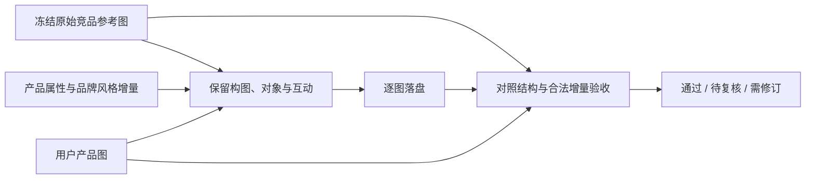
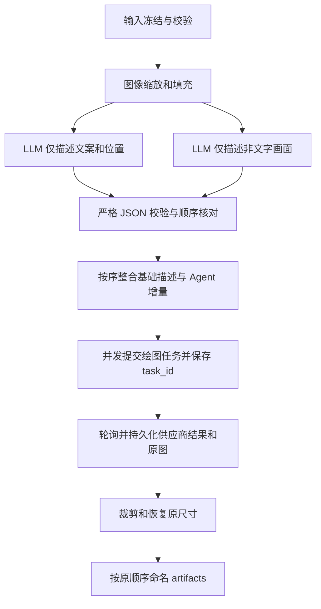

# 电商竞品图复刻：实现契约

本契约对应本次用户要求。供应商文档中的历史观察用于适配，不能视为当前真实调用验证。

## 当前目标：参考图优先复刻

最新用户口径：绘图是创意工作，少量不影响表达主旨和关键关系的装饰/几何/渲染差异可接受。
主题配色由Agent按产品图适配；除用户明确指定外，艺术风格保持各原图默认，不随配色自动改变。

用户明确纠正：原始竞品参考图是视觉对齐目标，提示词和分析描述只是辅助。
保留原图构图、版式、对象数量/身份和互动关系，包括包装、道具、污渍、水迹、手部和演示动作。
允许按有依据的增量修改产品文案、尺寸规格、材料和外观，以及全图品牌配色、色调和艺术风格；
这些要求不能改变主要表达、关键动作或反转对照身份；少量无损主旨的装饰变化不自动失败。
此前静物化、删除表现元素、用布局框代替原图的方案已撤回。历史记录保留，不追认为复刻通过。

新任务使用 alignment_policy=reference-creative-v1。生成必须携带完整原图；验收必须同时携带
原始参考图、成图和产品图，并绑定原图/成图/契约哈希。新输入拒绝 layout/rebuild。
scene/instruction 仅补充产品/品牌说明；结构化对象/布局/排除元素的非空覆盖在准备时拒绝。
验收对原图检查结构、对合法增量检查产品/品牌；不得把允许的配色和艺术风格变化判成结构失败。
已有的按需分析、逐图落盘、稳定ID、小样本选择和有预算的单图修订保留。
详细字段、验收指标、迁移及历史恢复边界见 [当前逐图复刻契约](DESIGN-V2.md)。



以下保留通用输入/几何/恢复规则及v1历史流程；与上述目标冲突的旧描述不用于新任务。

## 工作区与顺序

MCP 安装根（读取 `.env`）和 Agent 业务工作区（读取图片、写出产物）是独立路径。
启动时显式给出 `--project-root`，安装根凭据不随业务目录变化。当前源码默认任务级工作区：
`inspect_inputs` / `prepare_run` 传绝对 `workspace`，后续用返回的 `run_id`。
传 `--workspace` 保留旧固定模式和 `thread_id` 恢复；迁移及隔离边界见 [TASK-WORKSPACES.md](TASK-WORKSPACES.md)。
不依赖 Host cwd，也不自动猜测 Agent 当前项目。
每个工作区只允许一个活动图执行者（跨进程文件锁）；单图中的生成任务按并发预算运行。
这是单机 SQLite 方案，不支持多机共享网络文件系统上的并发写入。

输入为 `references/<group>/*.jpg|*.png`、`products/*.jpg|*.png`、`brief/*.md`。
图片组名支持 Unicode 字母、数字、下划线及连字符；每组按文件名自然排序，数字 1、2、10。
同一自然序号的大小写/前导零冲突必须重命名；使用 `inspect_inputs` 返回的顺序。
只接受实际 JPEG/PNG 单帧图片，读取 EXIF orientation 后的显示尺寸作为业务尺寸。
拒绝路径穿越、符号链接和工作区外文件。已发布v0.1.2的文件和返回图片限制为50 MiB；v0.1.3默认不限大小，显式max-input-bytes/max-download-bytes才启用。

`prompts/<group>.json` 可缺省；存在时必须是严格 JSON 数组，长度精确匹配图片数。
重复 JSON 键、NaN、未知字段和代码围栏均拒绝。例：

```json
[
  {},
  {
    "scene": "白色背景中摆放用户的红色陶瓷杯，保持参考图构图。",
    "instruction": "只使用 brief 中明确记载的产品规格。"
  },
  {
    "texts": []
  }
]
```

v1 `{}` 保留基础描述，`scene` 完整覆盖画面描述；新版 scene 仅表达产品/品牌属性说明；`texts` 完整覆盖文案块数组（`[]` 清空文字，但不得重排原区域）；
`instruction` 追加要求。文案块包含 `content`、`css` 和 `box`；box 的 x/y/width/height
以原图宽高归一化到 0..1000，必须处于原图边界内。CSS 是给绘图模型的描述数据，不执行 HTML。
准备阶段冻结全部图片、brief 和增量；之后修改原文件不会改变旧 thread，应再次 prepare。
v1 产品图全部作为绘图参考；图片 1 是竞品构图图，后续图片是用户产品图。
v2 的图片角色由参考策略决定，详见上节。

## v1 StateGraph（保留用于历史任务恢复）



图状态使用 `@dataclass GraphState`，SQLite `AsyncSqliteSaver` 负责节点 checkpoint；另一个
SQLite 操作日志负责 LLM 缓存、尝试次数、提交意图、task_id 和结果。两个库作用不同。
图像原件、准备图、LLM 原始 JSON、绘图原图放在工作区 `.replicator/`，恢复需要一并保留。
这些数据可能包含业务信息，只留本地；不进入 Git 或交付物。

两类 LLM 节点并行；各自按配置的图片数和实际编码后请求字节数贪心分批。
系统提示要求单个严格 JSON 对象，其 images 数组显式分隔图片对象。
请求携带 `response_format=json_schema` 和 `strict=true`；这是本实现的 structured-output
策略，不向供应商发送未定义的 `structured_output` 字段。返回逐项进行 Pydantic 严格验证，
数量、image_id 及顺序必须与输入完全一致；不靠输出位置猜测丢失图片的身份。
发送前展开 Pydantic 的本地 `$defs`/`$ref`，以兼容供应商转发到 Gemini 的
`generation_config.response_schema`。该转发链路还拒绝 `additionalProperties` 与
`exclusiveMinimum`：出站 schema 对前者使用描述约束，对后者使用 inclusive minimum 加严格大于描述；
完整原始 schema 同时放入系统提示，返回仍使用原始 Pydantic 模型严格校验，
拒绝未知字段和零宽高等不合格结果。出站 schema 是兼容子集，不等价于完整本地验证，不降级自由文本。
文案位置是模型估计值，结构校验不能证明视觉定位准确，真实质量需人工/视觉验收。

## 几何变换

选择同时满足边长 <=4096、两边为 16 倍数、比例 <=3:1、总像素 655360..8294400 的画布。
优先降低缩放幅度和填充面积；等比缩放内容后居中白色填充，并记录原尺寸、缩放尺寸和裁剪框。
LLM 根据元数据忽略填充；绘图提示明确内容区域和文案坐标变换。
后处理先核对供应商实际返回尺寸等于请求画布，再去除填充并还原原尺寸。
尺寸不匹配时保留原图并报错，避免错误裁剪；不会为了尺寸不匹配重新收费生成。
输出保留供应商实际 JPEG/PNG 编码类别；JPEG 处理会重新编码，缩放也不能保证像素无损。
命名为 `<group>_<组内从001开始的编号>_<真实task_id>.png|.jpg`。

## 恢复与副作用

LLM 每批主模型 `gemini-3.8-flash` 最多尝试三次，之后备用 `gemini-3.7-flash` 最多三次。
无效 JSON、数量/顺序错误、截断均计入尝试次数；次数和成功结果持久化，resume 不重置预算。
LLM 缓存按实际分析请求确定，仅修改 Agent 增量可复用反推结果。
HTTP 400/401/403/404/413/415/422 表示需要修正请求或配置，立即阻塞该批次，
不自动重试或切换备用模型；恢复相同请求仍阻塞。其他错误仍遵守上述尝试上限。
LLM 非 200 响应在 `.replicator/errors/<diagnostic_id>.json` 保存限长的脱敏错误字段、
状态码、响应长度和 SHA-256；不保存原始 HTTP 正文、请求头或输入图片。
非 JSON 和超大错误正文只保留元数据。工具错误与操作日志引用 diagnostic_id，
不直接展示上游错误正文。请求 schema 修复会形成新的分析缓存键，旧尝试记录保留。

prepare 的 `options.image_model` 选择系列，默认 `gpt-image-2.5-flare`，也可选
`gpt-image-2.5-sunburst`。每张图按预处理后实际提交画布的长边 L 自动路由：
L <=1024 使用无后缀版本；1024 < L <=2048 使用 `-2k`；2048 < L <=4096 使用 `-4k`。
宽、高任一边都计入长边，不根据原图尺寸或恢复后的产物尺寸判断。
实际提交模型在首次 POST 前写入 SQLite，重试保持该模型，get_run 的 jobs[].model 可查看。
已有 task_id、完成产物和未知提交保留原记录，不因新增路由策略重新收费提交；旧版已尝试
但缺少 model 字段的记录继续使用当时的无后缀模型。
使用 `/v1/images/generations?async=true`，参考图采用 image 数组的 Data URL；真实多图兼容性
尚待验证。已接受的任务使用 GET 查询；支持 NOT_START、IN_PROGRESS、SUCCESS、FAILURE。
成功图像来自供应商结果中的 `data.data` 数组；必须恰好一张，避免静默忽略额外图片。

每个绘图操作总计最多三次 POST 尝试。仅明确未建立连接，或已有任务被明确报告 FAILURE，
才自动重试；后者可能再次收费，所有旧 task_id 和失败响应保留在操作日志。
已知 task_id 的超时/查询失败/下载失败只恢复查询或下载，不能重新提交。
HTTP 错误、写入或读取超时、成功响应缺 task_id，或进程在“提交中”退出，均属于结果未知，
自动停止 POST。通过供应商查询/后台取得原 task_id，再调用 reconcile_submission 绑定并恢复。
若无法找回 task_id，保持阻塞，不宣称框架能在没有供应商幂等键的情况下保证恰好执行一次。

`execute_run` 是明确的收费执行入口；取消 Host 请求或终止 MCP 不撤销已发生的上游任务。
下次启动后再次 execute 相同 run_id 恢复（固定模式兼容 thread_id）。提交间隙用 durable 意图记录保护，
成功输出下载完成后使用原子写入落盘。最终产物已存在且内容不同时拒绝覆盖。

## 当前验证边界

最新reference-creative-v1策略通过116项本地测试。A14第06张的蓝色水彩与擦拭关系保留，
少量页眉装饰已被用户明确接受，已登记通过。A15全套按产品主题配色、默认继承各参考艺术风格，
实际进度和结论见 [VALIDATION.md](VALIDATION.md)，不能继续使用此前严格判定作为当前标准。
下方首图记录是早期供应商兼容性验证范围，不能代替当前视觉验收结论。

受控替身与真实 LangGraph/SQLite、官方 MCP SDK stdio 客户端用于验证流程和协议。
2026-10-27 已在 Windows 使用用户级密钥完成首图小样本：gemini-3.8-flash 的文案与画面
严格 JSON 分析各一次成功；gpt-image-2.5-flare-2k 接收一张参考图和一张产品图 Data URL，
一次提交成功，返回 800×1360 PNG 并恢复为 790×1357。
仅此单图范围通过；备用模型成功路径、批量上限、更多尺寸/模型和全面视觉质量尚未验证。
本次供应商结果域名 files.anyroutes.cn 经用户授权仅加入测试启动参数，未扩大全局默认白名单。
v0.1.3采用opt-in-v1：三项启动限制缺省为None，资源返回null，表示不限制；显式正整数才启用相应限制，0/负值非法。未指定token限制时省略max_tokens，供应商上限仍生效。已发布v0.1.2仍采用0阻塞旧策略；不将当前源码行为追认为旧版行为。
下载仅允许显式 HTTPS 域名，无重定向，不向图像 URL 发送 API 密钥；域名还应由部署环境的
网络出口策略限制。应用层 DNS 检查不能独立提供完整网络隔离。

### 指定文案与文字主题的提交前解析（plan version 6）

文字LLM节点保留参考图转录和CSS作为分析证据，不把参考CSS直接当作最终主题。
Agent将明确文案修改提交为`text_replacements: [{"old":"青苹果","new":"橙子","source":"products/my-product.png"}]`。
构造阶段进行不区分大小写的字面替换，保留原box和排版；规则未匹配、重叠、串联、与显式texts冲突时阻止绘图。
替换后的最终texts标记为explicit_replacement，提交前检查旧值不残留、新值存在，并为每条规则添加成图验收项。
自然语言instruction依然可用，但精确产品标签等必须通过结构化替换或完整texts表达，不能只依赖模型自行解释说明。

Agent指定`design.brand_style.text_color`（六位HEX）时，构造阶段覆盖结构化text块CSS的foreground color，
消除旧CSS的重复color声明，保留字号、字重、坐标和背景。未指定时保留原文字样式，不猜测品牌色。
它独立于文本内容的reference_transcription角色：文字可保持原文，但最终文字颜色应使用品牌色。
提交前逐块校验，出图新增text_theme检查；抗锯齿和自然色差允许，明显保留旧主题字色不通过。
此配置不代表更换艺术媒介，也不对未被结构化为text块的报告影像、印章或场景物体强行改色。
任意自然语言的全部语义无法由静态校验保证；成图仍需视觉验收。

### 文案待修订时的用户选择

已有明确修订信息（例如05的青苹果→橙子）直接执行修订，不重复索取。
若文案处于待修订且缺少修订信息，Agent先说明具体字段并询问用户补充。只有用户明确选择继续不修改时，
该部分文案才沿用原竞品参考配置；无回复不视为同意。将用户选择及回退字段写入此次brief/修订记录。
回退仅针对未确定的文案，不撤销产品身份/花色替换，也不撤销品牌主题及文字颜色适配；保留已有事实支持的修改。
参考图的参数和宣称仍是参考来源，不变成已核实产品事实。不虚构缺失参数，不删除污渍、手或对象互动。
通过新修订任务生成并重新验收，不能直接把旧needs_revision结果改成accepted，也不以此触发无限自动重绘。
现有text_replacements、texts、brand_style与prepare_revision能力即可表达该分支；询问和用户选择由Agent负责，
服务端继续执行结构、文案和文字主题校验。当前05修订信息已明确，不需要启用未确定文案的回退。
