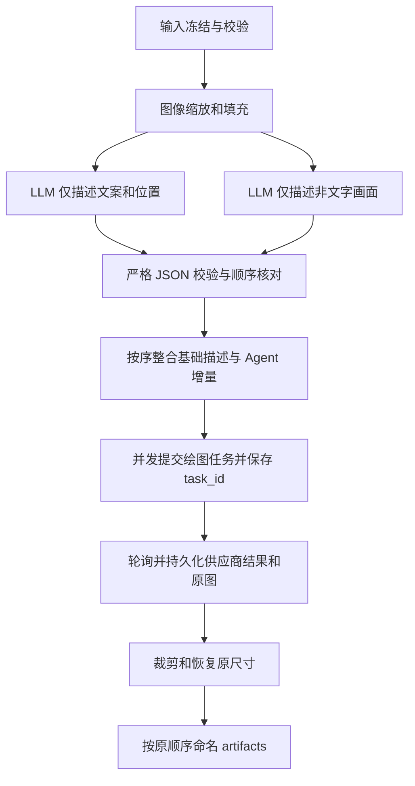

# 电商竞品图复刻：实现契约

本契约对应本次用户要求。供应商文档中的历史观察用于适配，不能视为当前真实调用验证。

## 工作区与顺序

MCP 安装根（读取 `.env`）和 Agent 业务工作区（读取图片、写出产物）是独立路径。
启动时显式给出 `--project-root` 与 `--workspace`，不依赖 Host 的 cwd。
每个工作区只允许一个活动图执行者（跨进程文件锁）；单图中的生成任务按并发预算运行。
这是单机 SQLite 方案，不支持多机共享网络文件系统上的并发写入。

输入为 `references/<group>/*.jpg|*.png`、`products/*.jpg|*.png`、`brief/*.md`。
图片组名支持 Unicode 字母、数字、下划线及连字符；每组按文件名自然排序，数字 1、2、10。
同一自然序号的大小写/前导零冲突必须重命名；使用 `inspect_inputs` 返回的顺序。
只接受实际 JPEG/PNG 单帧图片，读取 EXIF orientation 后的显示尺寸作为业务尺寸。
拒绝路径穿越、符号链接和工作区外文件。文件和返回图片限制为 50 MiB。

`prompts/<group>.json` 可缺省；存在时必须是严格 JSON 数组，长度精确匹配图片数。
重复 JSON 键、NaN、未知字段和代码围栏均拒绝。例：

```json
[
  {},
  {
    "scene": "白色背景中摆放用户的红色陶瓷杯，保持参考图构图。",
    "instruction": "只使用 brief 中明确记载的产品规格。"
  },
  {
    "texts": []
  }
]
```

`{}` 保留基础描述；`scene` 完整覆盖画面描述；`texts` 完整覆盖文案块数组（`[]` 删除全部文案）；
`instruction` 追加要求。文案块包含 `content`、`css` 和 `box`；box 的 x/y/width/height
以原图宽高归一化到 0..1000，必须处于原图边界内。CSS 是给绘图模型的描述数据，不执行 HTML。
准备阶段冻结全部图片、brief 和增量；之后修改原文件不会改变旧 thread，应再次 prepare。
产品图全部作为绘图参考；图片 1 是竞品构图图，后续图片是用户产品图。

## StateGraph



图状态使用 `@dataclass GraphState`，SQLite `AsyncSqliteSaver` 负责节点 checkpoint；另一个
SQLite 操作日志负责 LLM 缓存、尝试次数、提交意图、task_id 和结果。两个库作用不同。
图像原件、准备图、LLM 原始 JSON、绘图原图放在工作区 `.replicator/`，恢复需要一并保留。
这些数据可能包含业务信息，只留本地；不进入 Git 或交付物。

两类 LLM 节点并行；各自按配置的图片数和实际编码后请求字节数贪心分批。
系统提示要求单个严格 JSON 对象，其 images 数组显式分隔图片对象。
请求携带 `response_format=json_schema` 和 `strict=true`；这是本实现的 structured-output
策略，不向供应商发送未定义的 `structured_output` 字段。返回逐项进行 Pydantic 严格验证，
数量、image_id 及顺序必须与输入完全一致；不靠输出位置猜测丢失图片的身份。
文案位置是模型估计值，结构校验不能证明视觉定位准确，真实质量需人工/视觉验收。

## 几何变换

选择同时满足边长 <=4096、两边为 16 倍数、比例 <=3:1、总像素 655360..8294400 的画布。
优先降低缩放幅度和填充面积；等比缩放内容后居中白色填充，并记录原尺寸、缩放尺寸和裁剪框。
LLM 根据元数据忽略填充；绘图提示明确内容区域和文案坐标变换。
后处理先核对供应商实际返回尺寸等于请求画布，再去除填充并还原原尺寸。
尺寸不匹配时保留原图并报错，避免错误裁剪；不会为了尺寸不匹配重新收费生成。
输出保留供应商实际 JPEG/PNG 编码类别；JPEG 处理会重新编码，缩放也不能保证像素无损。
命名为 `<group>_<组内从001开始的编号>_<真实task_id>.png|.jpg`。

## 恢复与副作用

LLM 每批主模型 `gemini-3.8-flash` 最多尝试三次，之后备用 `gemini-3.7-flash` 最多三次。
无效 JSON、数量/顺序错误、截断均计入尝试次数；次数和成功结果持久化，resume 不重置预算。
LLM 缓存按实际分析请求确定，仅修改 Agent 增量可复用反推结果。

prepare 的 `options.image_model` 选择系列，默认 `gpt-image-2.5-flare`，也可选
`gpt-image-2.5-sunburst`。每张图按预处理后实际提交画布的长边 L 自动路由：
L <=1024 使用无后缀版本；1024 < L <=2048 使用 `-2k`；2048 < L <=4096 使用 `-4k`。
宽、高任一边都计入长边，不根据原图尺寸或恢复后的产物尺寸判断。
实际提交模型在首次 POST 前写入 SQLite，重试保持该模型，get_run 的 jobs[].model 可查看。
已有 task_id、完成产物和未知提交保留原记录，不因新增路由策略重新收费提交；旧版已尝试
但缺少 model 字段的记录继续使用当时的无后缀模型。
使用 `/v1/images/generations?async=true`，参考图采用 image 数组的 Data URL；真实多图兼容性
尚待验证。已接受的任务使用 GET 查询；支持 NOT_START、IN_PROGRESS、SUCCESS、FAILURE。
成功图像来自供应商结果中的 `data.data` 数组；必须恰好一张，避免静默忽略额外图片。

每个绘图操作总计最多三次 POST 尝试。仅明确未建立连接，或已有任务被明确报告 FAILURE，
才自动重试；后者可能再次收费，所有旧 task_id 和失败响应保留在操作日志。
已知 task_id 的超时/查询失败/下载失败只恢复查询或下载，不能重新提交。
HTTP 错误、写入或读取超时、成功响应缺 task_id，或进程在“提交中”退出，均属于结果未知，
自动停止 POST。通过供应商查询/后台取得原 task_id，再调用 reconcile_submission 绑定并恢复。
若无法找回 task_id，保持阻塞，不宣称框架能在没有供应商幂等键的情况下保证恰好执行一次。

`execute_run` 是明确的收费执行入口；取消 Host 请求或终止 MCP 不撤销已发生的上游任务。
下次启动后再次 execute 相同 thread_id 恢复。提交间隙用 durable 意图记录保护，
成功输出下载完成后使用原子写入落盘。最终产物已存在且内容不同时拒绝覆盖。

## 当前验证边界

受控替身与真实 LangGraph/SQLite、官方 MCP SDK stdio 客户端用于验证流程和协议。
没有调用真实收费 API；没有验证两个 Gemini 型号的严格 JSON、多图上限、输出容量和视觉质量，
也没有验证 GPT Image 的 Data URL 多图行为及当前返回画布尺寸。
预算必须通过启动参数显式配置，0 表示未配置、禁止收费执行；不将猜测数字写成供应商上限。
下载仅允许显式 HTTPS 域名，无重定向，不向图像 URL 发送 API 密钥；域名还应由部署环境的
网络出口策略限制。应用层 DNS 检查不能独立提供完整网络隔离。
